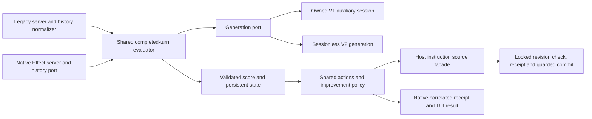

# OpenCode V2 migration: collected results and final design

The migration is implemented in isolated agent commits and integrated into this checkout. The original assessment is preserved in [V2-MIGRATION.md](V2-MIGRATION.md); the executable work breakdown and commit ledger are in [V2-IMPLEMENTATION-PLAN.md](V2-IMPLEMENTATION-PLAN.md). Installation instructions describe the built checkout, not a newly published registry release.

## Reusable design

One evaluator, rubric/parser, state store and instruction transaction layer serve both hosts. Host adapters handle their different SDK contracts rather than constructing a pretend legacy client inside V2.

| Boundary | Implementation | Responsibility |
| --- | --- | --- |
| Evidence | `history.ts`, `history-port.ts`, `v2-history.ts` | Real tools/errors, completed prefixes, distinct agent ranges, explicit archive/window coverage, bounded pagination and provenance. |
| Generation | `generation.ts`, `hosts/v1-generation.ts`, `hosts/v2-generation.ts` | One admitted logical request, exact V1 session ownership, public Effect cancellation, bounded retained data and quarantine of uncertain outcomes. |
| Lifecycle | `runtime.ts`, `native-events.ts` | Timers/jobs, instance/session revisions, cancellation at deletion/reset/disposal, and closed admission after event-feed termination. |
| Judge validation | `scorer.ts`, `scoring-json.ts`, `scoring-validation.ts`, `scoring-evidence.ts` | Shared rubric, finite category validation including zero, escaped aggregate evidence budget, conservative weakness grouping and partial-observation exclusion. |
| Persistence | `state.ts`, `state-sync.ts`, `lock.ts`, `prompt-utils.ts` | Disk-authoritative reconciliation, reset/deletion fences, owned locks, honest atomic-write failures and strict score acknowledgement. |
| Instruction mutation | `instruction-transaction.ts`, `instruction-migration.ts`, host source managers | Canonical targets, exact revisions, backups/receipts, conflict-aware rollback, recoverable migrations and checks after write staging. |
| Native interface | `server.ts`, `native-actions.ts`, `command-results.ts`, `v2-rpc.ts`, `tui.ts` | Direct administrative commands, real tools, location/session-bound receipts, replay without mutation and readable results outside chat history. |

The package root remains the legacy function. `./server` exports a native Effect implementation plus a lazy legacy `server()` function; real hosts proved which member each loader selects. `./tui` similarly provides native setup and a benign legacy compatibility entry. Client/schema 2.2.2 are ordinary runtime dependencies because clean native hosts do not supply them. The legacy root has no eager native imports.

## All isolated chunks

Each agent verified the relevant pinned contracts, implemented its owned surface, tested it, reviewed the diff and committed it. The coordinator cherry-picked the commits in dependency order and preserved additive changes at integration conflicts.

| Chunk | Agent | Integrated implementation |
| --- | --- | --- |
| C01: history and evaluation correctness | history_scoring | `87aafe3` |
| C02: scoring validation and grouping | lifecycle_commands | `e8c1176` |
| C03: persistent state, locks and writes | storage_instructions | `756bc8b` |
| C04: instruction/config transactions | storage_instructions | `c1af22c`, staging fix `ba714ea` |
| C05: pinned SDK and loader contracts | lifecycle_commands | `faafa4d` |
| C06: shared generation and V1 adapter | lifecycle_commands | `4885f53`; final V1 tool guard by history_scoring: `dcc0519` |
| C07: lifecycle/actions and V1 routing | history_scoring | `73df794`, disposal/deletion fix `16e991d` |
| C08: V2 history and shared evaluation | history_scoring | `e04dcea` |
| C09: V2 instruction provenance | storage_instructions | `b700102` |
| C10: native setup, commands/tools/TUI | history_scoring | `55fca50`, pagination/event supervision `2ea8ce3`, child provenance `0b3a48a`, child threshold `1d9b8b6` |
| C11: packaged native acceptance | lifecycle_commands | `30a0117`, V1 denial `92d06b2`, child after reload `9c4161f`; runtime evidence in [V2-NATIVE-ACCEPTANCE.md](V2-NATIVE-ACCEPTANCE.md) |
| C12: installation/support/release docs | storage_instructions | `5bbf228`, final safety clarification `3de4f01` |

The ledger retains original agent commit IDs and per-chunk tests. Additional source-grounded V1 tool isolation is documented in [V2-C10-V1-TOOL-ISOLATION.md](V2-C10-V1-TOOL-ISOLATION.md).

## What the real hosts verified

The exact packed package was installed into clean consumers outside repository development dependencies. Hosts used isolated configuration/home directories and a deterministic loopback provider. No external inference or publication was performed.

| Real-host check | Result |
| --- | --- |
| OpenCode 1.18.23 production package | Dual server loader selected the legacy function; `kasper_control` and six compatibility tools registered. |
| V1 judge tool isolation | Exact packed generation port advertised no tools; a forced write was denied, no file was created, and the owned auxiliary session was deleted after the valid continuation response. |
| OpenCode 2.2.2 production package | Native Effect setup loaded from the same package. |
| Native administrative commands | Status, replay and direct session command produced zero provider calls and zero chat messages. |
| Native terminal results | A supervised Windows PTY captured the actual renderer displaying `Kasper status` from the command-result event. |
| Tool/history/judge flow | Real Code Mode tool input/output reached durable history and the judge; one judge request persisted a 0.8 score without creating a child session. |
| Result refresh | Replayed the receipt without another judge request. |
| Reset during generation | Cancelled evaluation, cleared sessions, prevented late score commit and overlapping retry. |
| Public location reload | Initialized a new plugin scope; status worked and reload made no provider call. |
| Historical child after reload | Parent-invoked scoring retained the exact child source/parent IDs and `subagent` classification, persisted 0.8, and did not record the parent. |

The final native V2 artifacts are in `%TEMP%/kasper-sdk-native-RUKLFE/`; production V1 artifacts are in `kasper-sdk-native-xRYz5P/`, the forced-write check is in `kasper-sdk-native-HNb8RR/`, and historical child acceptance is in `kasper-sdk-native-eiZlgf/`, under the same parent. The acceptance report records detailed methods, receipts, logs, source references and reproduction commands. V1 native dialog delivery and full terminal interaction/accessibility are not claimed by these checks.

## Corrections established during verification

Tests and actual hosts changed several assumptions in the initial guide:

- An unsupported V1 `stop/message` hook shortcut could not stop chat dispatch. V1 now uses its supported model/tool flow; V2 administrative commands execute directly.
- Separate root/server exports alone were insufficient for the V1 package loader. The measured dual server object preserves both host routes.
- Optional schema/client peers were insufficient for clean native package loading. Runtime dependencies now supply them.
- Native continuation cursors cannot be combined with initial ordering/filter selectors. Actual pagination now follows that runtime contract.
- Instruction files could change during asynchronous staging. The source revision is checked again immediately before replacement; a reproduced external edit is preserved.
- History preprocessing could hide omissions from the judge budget. Those omissions now mark observations partial and exclude them from improvement evidence.
- Current-window reads needed a second execution-anchor check. Unexpected lifecycle-feed termination also now revokes admission.
- `--dry-run` and `--show` parsing needed exact tokens; regressions verify that these paths do not mutate instructions.

## Practical support boundaries

Historical scoring needs an explicit authenticated same-server archive connection. Complete instruction coverage needs authoritative configuration plus a caller assertion matching the host's discovery policy. Unknown/virtual/transformed agent origins remain read-only; writes require explicit editable targets or a Kasper-owned overlay. Missing coverage prevents judging or writing rather than substituting guessed sources.

Cancellation protects local state, but it is not a provider stop or spend limit. The actual local provider completed its delayed response after reset. Native generation also omitted `max_tokens`/`max_completion_tokens` despite model output-limit metadata. The capability remains `enforcedOutputLimit: false`; uncertain outcomes suspend generation for the current plugin scope. Reload creates a new scope without proving that old provider work stopped.

Expiry removes active metadata; it does not deactivate injected guidance. Instruction activation is pending/unconfirmed until verified. Receipts and journals support deliberate recovery, but external file writes cannot be turned into a universal filesystem compare-and-swap or an atomic file-plus-state transaction.

Use [SUPPORT.md](SUPPORT.md), [MIGRATION.md](MIGRATION.md) and [RELEASE-CHECKLIST.md](RELEASE-CHECKLIST.md) for the precise supported subset and installation/recovery procedure.

## Final combined checks

**705 tests passed, 27 opt-in external/model E2E tests skipped, zero failed; 1,756 assertions across 45 files.** Frozen installation, application typecheck, pinned SDK contract typecheck, build and lint passed. Lint has two pre-existing unused-suppression warnings. Actual native fixtures are separate positive acceptance evidence; the skipped external/model suite is not presented as tested.

All twelve chunks, their necessary follow-ups and the final collected documentation are committed locally. No publication or registry qualification is part of this result.
